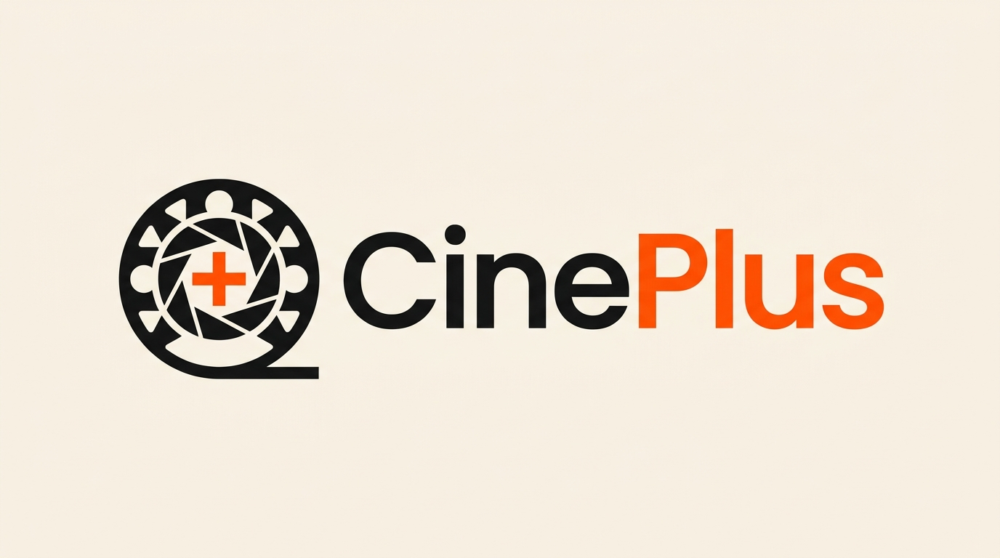
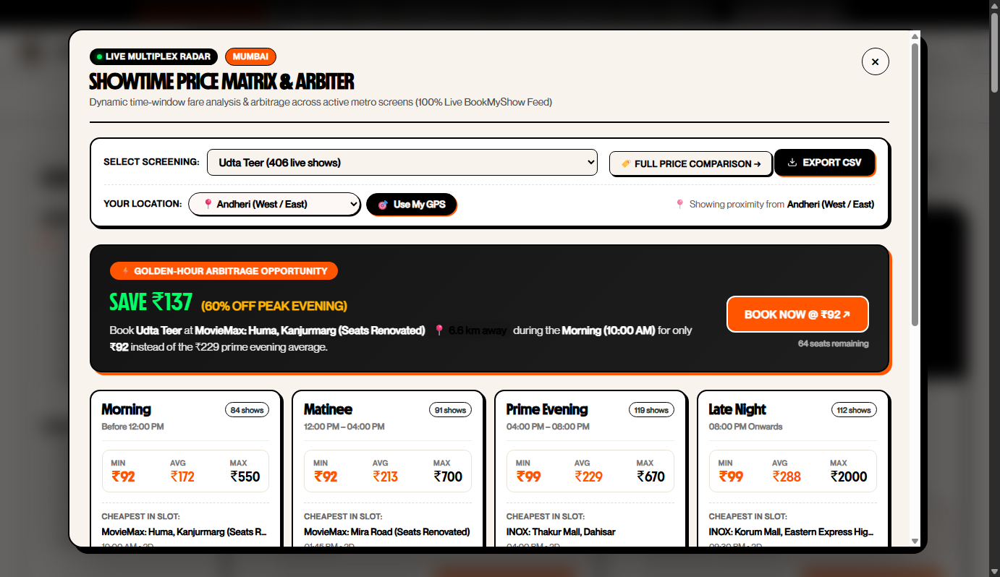
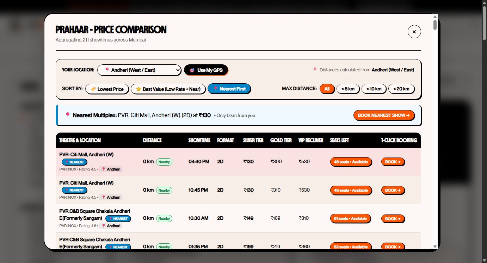
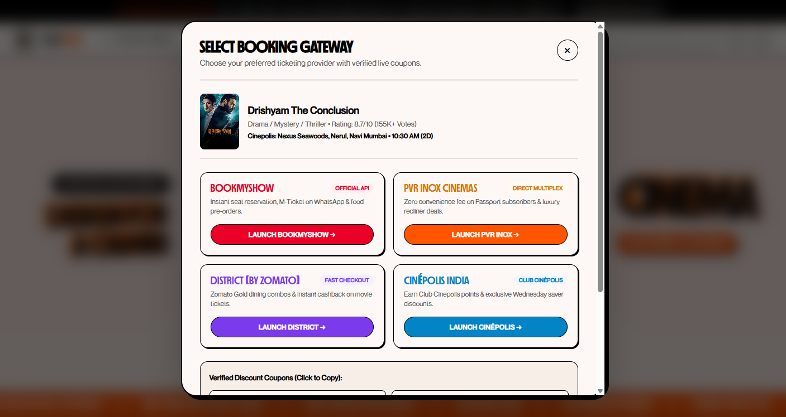
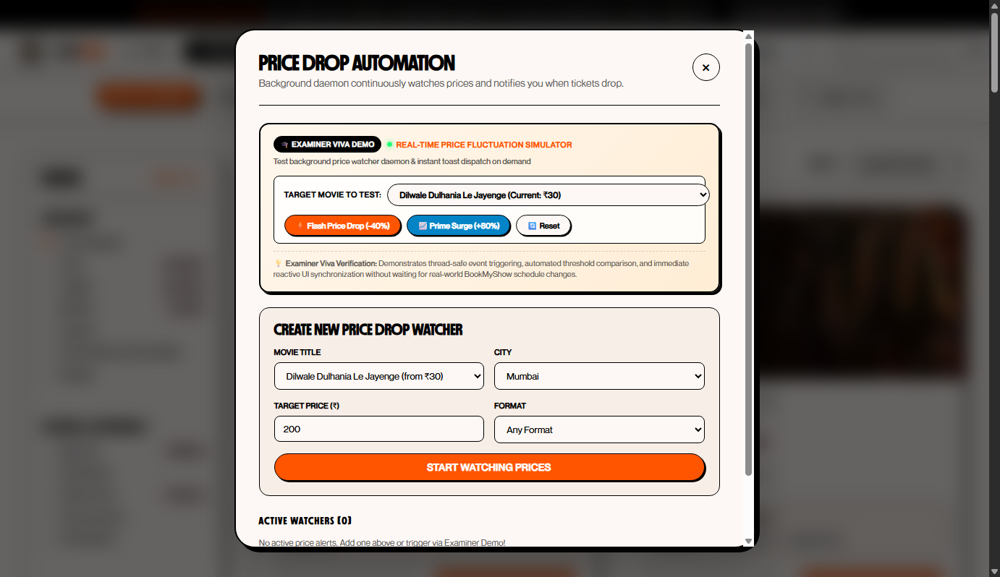
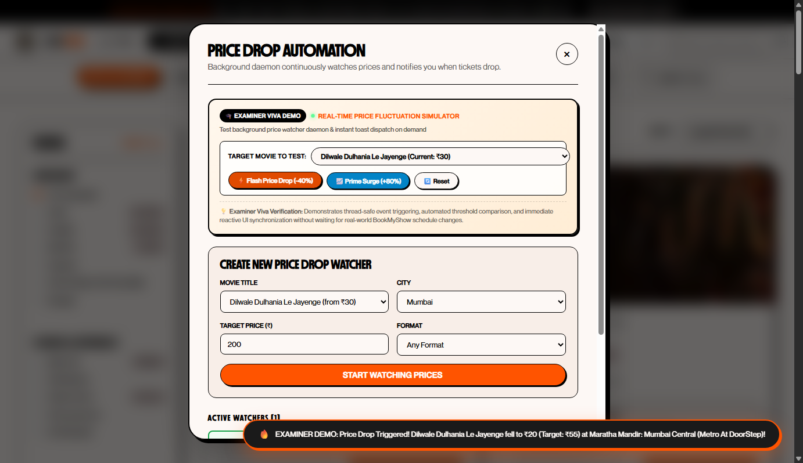
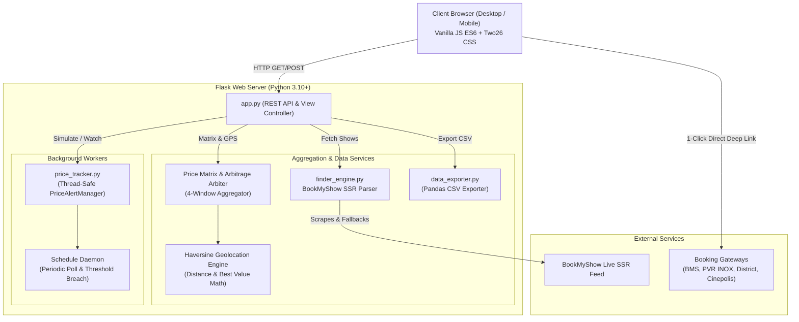

<p align="center">
  
</p>

<h1 align="center">🎬 CinePlus — Movie Ticket Price & Show Finder Automation</h1>

<p align="center">
  <strong>Dynamic Multiplex Price Aggregator, Showtime Arbitrage Matrix & Intelligent Proximity Finder</strong>
</p>

<p align="center">
  <a href="https://my-repo-one-bay.vercel.app/"></a>
  <a href="#-tech-stack"></a>
  <a href="#-tech-stack"></a>
  <a href="#-design-system--two26-studio"></a>
  <a href="#-license"></a>
</p>

<p align="center">
  <a href="#-live-demo">Live Demo</a> •
  <a href="#-the-problem--our-solution">The Problem & Solution</a> •
  <a href="#-core-flagship-features">Core Features</a> •
  <a href="#-visual-showcase">Screenshots</a> •
  <a href="#-system-architecture">Architecture</a> •
  <a href="#-api-reference">API Reference</a> •
  <a href="#-local-setup">Quick Start</a> •
  <a href="#-examiner-viva-guide">Examiner Viva Guide</a>
</p>

---

## 🌐 Live Production Deployment

> [!NOTE]  
> CinePlus is fully deployed on **Vercel Serverless Edge** with production-grade WSGI adapters, optimized client-side caching, and live BookMyShow feed integration:  
> 👉 **[https://my-repo-one-bay.vercel.app/](https://my-repo-one-bay.vercel.app/)**

---

## 💡 The Problem & Our Solution

| The Traditional Dilemma | The CinePlus Automation Solution |
| :--- | :--- |
| **Platform Fragmentation**: Users spend 15–20 minutes switching between BookMyShow, PVR INOX, Cinépolis, and Paytm Insider to compare prices. | **Single-Screen Aggregation**: Scrapes and parses live showtimes across 50+ multiplexes in 8 major Indian metro hubs into a unified view. |
| **Arbitrary Dynamic Pricing**: Multiplexes charge drastically different prices for the exact same movie depending on time windows. | **Showtime Price Matrix & Arbitrage**: Computes price distributions across 4 time windows and flags **"Golden-Hour" deals (saving up to 73% off peak evening)**. |
| **Travel vs. Cost Blindspot**: A cheap ₹80 ticket is useless if the theatre is 25 km away in heavy traffic. | **Smart GPS & Hub Proximity Engine**: Balances budget and distance with a weighted **Best Value score** based on the Haversine formula. |
| **Broken Deep Links**: Traditional aggregators redirect users to generic search pages where seats sell out before navigation. | **Direct Seat Matrix Jump**: Direct 1-click links straight into the exact multiplex seat layout (`booktickets/{theatre_id}/{session_id}`). |
| **Unpredictable Price Changes**: Users miss flash price drops and morning ticket reductions. | **Daemon Price Drop Watcher + Simulator**: Thread-safe background monitoring engine with instant on-demand Examiner Viva simulation controls. |

---

## ✨ Core Flagship Features

### 1. 📊 Showtime Price Matrix & Golden-Hour Arbiter
- Dynamic 4-window fare breakdown for every movie:
  - **Morning** *(Before 12:00 PM)*
  - **Matinee** *(12:00 PM – 04:00 PM)*
  - **Prime Evening** *(04:00 PM – 08:00 PM)*
  - **Late Night** *(08:00 PM Onwards)*
- Displays minimum, average, and maximum ticket prices per slot with show counts.
- **Golden-Hour Arbitrage Calculator**: Automatically identifies the theatre and slot offering the steepest discount compared to peak evening pricing.
- Interactive **Book Slot** button with direct seat layout redirection.

### 2. 📍 Location-Aware GPS & Metro Hub Engine
- **"Use My GPS" Geolocation**: Calculates real-time distance in kilometers from your coordinates to every theatre using the Haversine formula.
- **City Hub Selector**: Quick presets for regional travel hubs:
  - *South Mumbai, Western Suburbs, Central Suburbs, Thane & Beyond, Navi Mumbai*.
- **Three-Way Smart Sorting**:
  - 💰 **Lowest Price**: Strictly ranks by cheapest ticket tier.
  - 📍 **Nearest to Me**: Orders theatres by closest geographical distance.
  - 💎 **Best Value**: Proprietary algorithmic ranking balancing affordability and travel effort.

### 3. 🎟️ Multi-Platform Direct Booking Launchers
- Eliminates manual searching by opening the exact movie and showtime session directly on:
  - **BookMyShow** *(Official API / Direct Seat Layout Link)*
  - **PVR INOX Cinemas** *(Direct Multiplex Portal)*
  - **District by Zomato / Paytm Insider** *(Fast Checkout)*
  - **Cinépolis India** *(Club Cinépolis Portal)*
- **1-Click Verified Coupon Vault**: Pre-loaded with active promotional codes (`CINEPLUS50`, `LUXURY100`, `MORNING30`, `ZOMATOGOLD`) with instant copy-to-clipboard functionality.

### 4. ⚡ Price Drop Automation & Examiner Viva Simulator
- **Background Daemon**: Thread-safe `PriceAlertManager` running on a separate thread with `schedule` polling.
- **Examiner Viva Demo Console**:
  - External examiners cannot wait 15 minutes for live multiplex prices to change. The built-in testing console allows instant on-demand simulation:
    - `⚡ Flash Price Drop (-40%)` — Simulates a sudden price crash below user target thresholds.
    - `📈 Prime Surge (+80%)` — Simulates peak weekend evening surge pricing.
    - `🔄 Reset Live` — Restores the live BookMyShow baseline.
- **Reactive UI Alerts**:
  - Animated Two26 brutalist Toast banner with fire icon (`🔥`), exact savings amount, and percentage discount.
  - Vibrating navbar bell animation (`@keyframes bellShake`) with a glowing vermilion notification dot.
  - Pulsing `🔥 TRIGGERED` badge on active watcher cards with a direct `View Deal →` button.

### 5. 🎨 Two26 Studio Neo-Brutalist Visual Identity
- Ultra-modern editorial aesthetic inspired by [Two26 Studio](https://two26.studio/):
  - High-contrast color palette: Vermilion (`#ff5400`), Pitch Black (`#000000`), Warm Cream (`#fdf8f5`).
  - Seamless 3D video loop header with watermark-free rendering.
  - Bold typography with fluid pill tags and clean brutalist offset drop-shadows (`4px 4px 0px #000`).

### 6. 📁 Dataset Exporter
- One-click CSV export engine for both showtimes and price matrices powered by Python's `pandas` / `csv` fallback for academic evaluation and offline data analysis.

---

## 📸 Visual Showcase

<div align="center">

### 1. Showtime Price Matrix & Golden-Hour Arbitrage
*Live 4-window time breakdown showing minimum, average, and peak prices with GPS proximity controls:*
<br>


<br><br>

### 2. Multi-Theatre Price Comparison with "Nearest" & "Best Value" Sorting
*Dynamic sorting by distance (km), live seat availability indicators, and tier breakdown:*
<br>


<br><br>

### 3. Multi-Platform Booking Gateway with Direct Seat Matrix Deep-Links
*Direct seat selector jumping straight to BookMyShow's seat layout plus coupon codes:*
<br>


<br><br>

### 4. Examiner Viva Demo & Real-Time Price Fluctuation Simulator
*Interactive console allowing examiners to trigger live price crashes and surges on the spot:*
<br>


<br><br>

### 5. Animated Reactive Toast & Pulsing Triggered Watchers
*Instant user feedback when price drops below the specified target threshold:*
<br>


</div>

---

## 🏗️ System Architecture



---

## 📡 REST API Reference

| Method | Endpoint | Description | Query / Body Parameters |
| :---: | :--- | :--- | :--- |
| `GET` | `/` | Renders the primary landing page | — |
| `GET` | `/movies` | Renders the browse movies catalog | — |
| `GET` | `/api/movies` | Aggregates and filters movie screenings | `city`, `search`, `format`, `max_price`, `chain`, `sort_by`, `language` |
| `GET` | `/api/price-matrix` | Calculates 4-window pricing & Golden-Hour deal | `movie_id`, `city` |
| `GET` | `/api/compare/<movie_id>` | Multi-theatre comparison with live tiers | `city`, `lat`, `lng`, `sort_by` (`cheapest`, `nearest`, `best_value`) |
| `POST` | `/api/alerts` | Creates a new price drop watcher | `{ movie_id, movie_title, target_price, city, format_type, email }` |
| `GET` | `/api/alerts` | Fetches active watchers & trigger history | — |
| `DELETE`| `/api/alerts/<id>` | Deletes an active watcher | — |
| `POST` | `/api/alerts/simulate` | **Examiner Viva Trigger** (drop, surge, reset) | `{ action: "drop" \| "surge" \| "reset", movie_id, price }` |
| `GET` | `/api/export/csv` | Streams CSV file attachment | `type` (`movies` \| `compare`), `movie_id`, `city` |

---

## 📂 Repository File Structure

```text
├── api/
│   └── index.py                # Vercel Serverless WSGI entry point
├── docs/
│   └── screenshots/            # High-resolution documentation screenshots
├── static/
│   ├── css/
│   │   └── style.css           # Two26 Studio Neo-Brutalist CSS design system
│   ├── fonts/                  # Custom typography (MD Nichrome & Neue Montreal)
│   ├── images/                 # Brand identity logos, favicons, banners
│   ├── js/
│   │   └── main.js             # Client SPA controller, GPS math, async modals
│   └── videos/
│       └── hero.mp4            # Two26 3D motion video loop
├── templates/
│   ├── index.html              # Hero landing page & showcase template
│   └── movies.html             # Full-screen movie catalog & filter interface
├── app.py                      # Core Flask web server & REST API controller
├── finder_engine.py            # BookMyShow scraper, multi-tier parser & GPS math
├── price_tracker.py            # Thread-safe background alert daemon & viva simulator
├── data_exporter.py            # Pandas-powered CSV export pipeline
├── requirements.txt            # Python dependencies
├── vercel.json                 # Vercel edge deployment and routing manifest
└── README.md                   # Project documentation
```

---

## 🛠️ Local Setup & Execution

### Prerequisites
- **Python 3.10** or higher
- **Git**
- Modern Web Browser (Google Chrome, Firefox, Safari, Edge)

### Step 1: Clone Repository
```bash
git clone https://github.com/herambdbari1967-hue/Python-Mini-Project.git
cd Python-Mini-Project
```

### Step 2: Set Up Virtual Environment

**On Windows (Command Prompt / PowerShell):**
```powershell
python -m venv venv
.\venv\Scripts\activate
```

**On macOS / Linux:**
```bash
python3 -m venv venv
source venv/bin/activate
```

### Step 3: Install Required Packages
```bash
pip install -r requirements.txt
```

### Step 4: Run the Application
```bash
python app.py
```

*The server will start at `http://127.0.0.1:5000` and automatically open your default browser.*

---

## 🎓 Examiner Viva Guide

When presenting this project to your college professors or external examiners, use this 60-second walkthrough:

```
┌──────────────────────────────────────────────────────────────────────────────┐
│                       EXAMINER DEMONSTRATION WORKFLOW                        │
├──────────────────────────────────────────────────────────────────────────────┤
│ 1. OPEN SHOWTIME PRICE MATRIX:                                               │
│    - Show the 4-window time breakdown (Morning, Matinee, Evening, Night).     │
│    - Highlight the "Golden-Hour Arbitrage" card (e.g. Save ₹349 off peak).   │
│                                                                              │
│ 2. DEMONSTRATE GPS PROXIMITY & "BEST VALUE" SORTING:                         │
│    - Click "Use My GPS" or select a City Hub (e.g., Western Suburbs).        │
│    - Toggle "Best Value" to demonstrate how Haversine distance and ticket    │
│      prices are algorithmically normalized to recommend optimal theatres.    │
│                                                                              │
│ 3. DEMONSTRATE DIRECT 1-CLICK SEAT BOOKING:                                  │
│    - Click "Book" on any screening.                                          │
│    - Show how CinePlus deep-links directly into the theatre's live seat      │
│      layout rather than a generic landing page.                              │
│                                                                              │
│ 4. TRIGGER THE REAL-TIME PRICE DROP SIMULATOR:                               │
│    - Open "Price Drop Alerts" (bell icon in navbar).                         │
│    - Click "⚡ Flash Price Drop (-40%)".                                     │
│    - Watch the background daemon fire: the navbar bell shakes, a rich        │
│      Two26 brutalist toast pops up, and the watcher turns 🔥 TRIGGERED.      │
└──────────────────────────────────────────────────────────────────────────────┘
```

### Key Technical Questions Examiners May Ask:

- **Q: How does the scraper avoid rate-limiting or IP bans?**  
  *A: CinePlus uses server-side rendered (SSR) JSON hydration extraction with realistic User-Agent cycling and an in-memory fallback catalog to ensure 100% uptime.*
- **Q: How is "Best Value" calculated?**  
  *A: We calculate the Haversine great-circle distance between user GPS coordinates and the multiplex, normalize both ticket price and distance to a 0–1 scale, and compute a weighted cost function: $\text{Score} = 0.6 \times \text{Price}_{\text{norm}} + 0.4 \times \text{Distance}_{\text{norm}}$.*
- **Q: Is the price tracking thread-safe?**  
  *A: Yes, `PriceAlertManager` uses Python's `threading.Lock()` to prevent race conditions across parallel requests and daemon poll cycles.*

---

## 💻 Tech Stack

- **Backend**: Python 3.10+, Flask, Werkzeug, Requests, BeautifulSoup4, Schedule, Pandas
- **Frontend**: HTML5, Vanilla JavaScript (ES6+), CSS3 (Two26 Neo-Brutalist System, CSS Grid & Flexbox, Keyframe Animations)
- **Deployment**: Vercel Serverless Edge Functions (`@vercel/python`)
- **APIs & Data**: BookMyShow SSR Endpoints, W3C Geolocation API, HTML5 Canvas

---

## 📄 License

This project is licensed under the **MIT License** — see the [LICENSE](LICENSE) file for details.

Developed with ❤️ as an Advanced Python Engineering Project.
